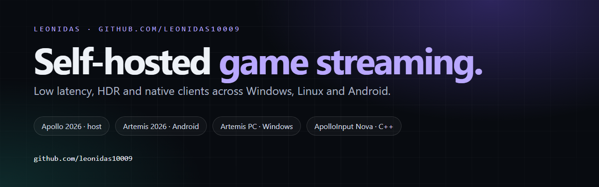

  

<h1 align="center">Leonidas · leonidas10009</h1>

  <strong>Self-hosted, low-latency game streaming.</strong> 
  Maintainer of <a href="https://github.com/leonidas10009/Apollo_2026">Apollo 2026</a> (Windows/Linux host)
  and <a href="https://github.com/leonidas10009/Artemis-2026">Artemis 2026</a> (Android / Android TV client) —
  independent forks in the Apollo · Sunshine · Moonlight ecosystem.

  
  
  

## Projects

| Project | What it is | Stack |
|---|---|---|
| **[Apollo 2026](https://github.com/leonidas10009/Apollo_2026)** | Self-hosted game streaming host for Windows and Linux: HDR virtual display, Web UI, AMD/Intel/NVIDIA encoding and Moonlight-compatible clients. | `C++` `Vue` |
| **[Artemis 2026](https://github.com/leonidas10009/Artemis-2026)** | Android client for Apollo 2026 and Sunshine: Android TV, tablets, AV1, virtual display control and remote power actions. | `Java` `C` |
| **[Artemis PC](https://github.com/leonidas10009/Artemis-pc)** | Windows desktop client built with Qt: game streaming, remote desktop mode, clipboard sync and power commands. | `C++` `Qt` |
| **[ApolloInput Nova](https://github.com/leonidas10009/apollo_input)** | MIT C++ library for virtual gamepads: ViGEmBus, uinput and HID backends, Xbox/DualSense/Switch/Steam profiles, anti-drift filtering. | `C++` |
| **[PuzzleCraft3D](https://github.com/leonidas10009/PuzzleCraft3D)** | Tools and algorithms for designing and solving interactive 3D puzzles. | `C#` |
| **[Argos](https://github.com/leonidas10009/argos)** | Hybrid TypeScript scraping engine with browser pool, stealth, rotating proxies and Bayesian provider memory. | `TypeScript` |

## What I focus on

- Low-latency video streaming: HDR, AV1, virtual displays and hardware encoding.
- Native clients: Android / Android TV, Windows and Qt, input and gamepad abstraction.
- Reproducible builds and release automation with GitHub Actions.

## Stack

`C++` `Qt` `Android` `Vue` `TypeScript` `Python` `GitHub Actions`

## Links

- Releases: [Apollo 2026](https://github.com/leonidas10009/Apollo_2026/releases) · [Artemis 2026](https://github.com/leonidas10009/Artemis-2026/releases) · [Artemis PC](https://github.com/leonidas10009/Artemis-pc/releases)
- Documentation: [Apollo 2026 docs](https://leonidas10009.github.io/apollo-2026-docs/) · [ApolloInput Nova API](https://leonidas10009.github.io/apollo_input/)

---

### En español

Desarrollo **Apollo 2026**, un host de streaming de juegos autoalojado para Windows y Linux, y **Artemis 2026**, su cliente para Android y Android TV. También mantengo **Artemis PC** (cliente Windows en Qt/C++) y **ApolloInput Nova** (librería C++ de gamepads virtuales).

> Apollo 2026 y Artemis 2026 son forks independientes y no oficiales del ecosistema Apollo / Sunshine / Moonlight. Todo el crédito a sus autores originales.
